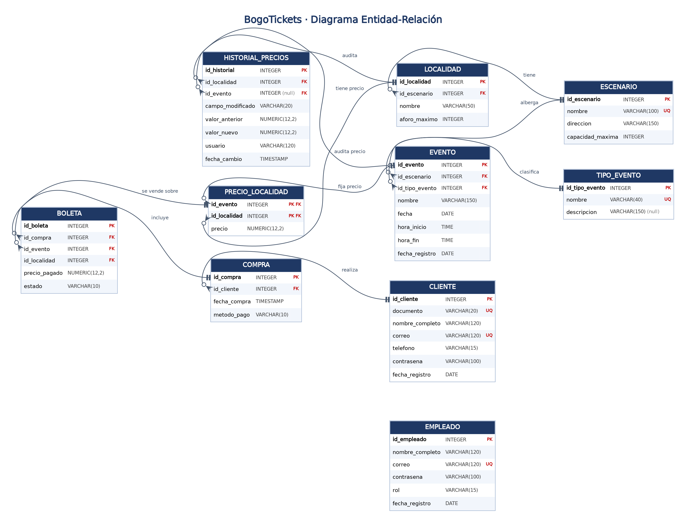

# BogoTickets

Sistema de venta de boletería para los escenarios de Bogotá: conciertos, teatro, fútbol, festivales, ferias y cine. Controla el aforo de cada localidad para impedir la sobreventa, registra las compras y genera reportes de ocupación y recaudo. Lo usan tres actores, cada uno con su propio inicio de sesión: el **cliente**, que consulta la cartelera y compra; el **administrador de escenarios y eventos**, que configura el catálogo y gestiona las ventas; y el **analista de ventas**, que consulta los reportes.

Proyecto final de Bases de Datos (grupo 020-83): base de datos en PostgreSQL, API REST con Spring Boot, JdbcTemplate y Spring Security, e interfaz web en HTML, CSS y JavaScript que usa la API.

## Integrante

- Dilan Alejandro Sanchez Escobar — 20222020252

## Requisitos previos

| Herramienta | Versión |
|---|---|
| PostgreSQL y pgAdmin 4 | PostgreSQL 14 o superior (probado en 14, 16 y 18) |
| Java (JDK) | 17 o superior (probado con 17, 21 y 25) |
| IDE | IntelliJ IDEA (la edición Community sirve) o VS Code con *Extension Pack for Java* |
| Git | cualquier versión reciente |

No hace falta instalar Maven: el proyecto trae Maven Wrapper (`mvnw` y `mvnw.cmd`). La primera ejecución necesita internet para descargar las dependencias.

## Instalación

### 1. Clonar el repositorio

```
git clone https://github.com/AlejandroSanchez85/Bases_De_Datos.git
cd Bases_De_Datos
```

### 2. Crear la base de datos (pgAdmin)

1. Conectado a la base `postgres`, abrir el Query Tool y ejecutar:
   ```sql
   CREATE DATABASE bogotickets ENCODING 'UTF8';
   ```
   El nombre va en minúsculas: así lo busca `application.properties`.
2. Abrir el Query Tool sobre `bogotickets` y ejecutar **en orden** los scripts `01` a `05` de la carpeta `sql/` (abrir el archivo y presionar F5, sin seleccionar nada). Cada script termina con una consulta de verificación.

| Orden | Script | Qué crea | Resultado esperado al final |
|---|---|---|---|
| 1 | `01_tablas.sql` | 10 tablas, restricciones e índices | 10 tablas con su número de restricciones |
| 2 | `02_funciones_triggers.sql` | triggers de reglas de negocio, función de compra y procedimiento de anulación | 11 triggers |
| 3 | `03_vistas.sql` | 7 vistas | 7 vistas |
| 4 | `04_datos.sql` | datos de prueba | 18 escenarios, 53 localidades, 10 tipos, 60 eventos, 177 tarifas, 220 clientes, 3 empleados, 4223 compras, 10059 boletas, 11 cambios en el historial |
| 5 | `05_usuarios_permisos.sql` | roles, usuarios y permisos | 3 usuarios y 3 roles; `usuario_app` aparece con `hereda = false` |

Los otros dos scripts no hacen falta para instalar: `06_consultas_api.sql` reúne las consultas con vistas y subconsultas que ejecuta la API, y `07_pruebas_reglas.sql` trae pruebas que violan cada regla y cada permiso a propósito. En ambos se selecciona una consulta o prueba y se ejecuta sola.

Los scripts se pueden volver a ejecutar para dejar los datos como al principio: `01` reinicia las tablas y `05` vuelve a dar los permisos. El script `05` no borra los usuarios de PostgreSQL si ya existen en el servidor (por ejemplo, de otra base): les quita los permisos que tenían en esta base y los vuelve a asignar. Antes de volver a ejecutar los scripts hay que detener la API.

### 3. Configurar la conexión

La conexión está en `src/main/resources/application.properties`:

```properties
spring.datasource.url=jdbc:postgresql://localhost:5432/bogotickets
spring.datasource.username=usuario_app
spring.datasource.password=${DB_PASSWORD:Cambiar_App_2026}
```

- La API entra con `usuario_app`, el usuario que crea el script `05`.
- Si PostgreSQL usa otro puerto (por ejemplo 5433), se cambia en la URL.
- La contraseña es la de ejemplo del script `05`. Si se cambia en la base, se puede escribir aquí o definir la variable de entorno `DB_PASSWORD`.

### 4. Ejecutar la aplicación

**Desde IntelliJ IDEA:** *File → Open* y elegir la carpeta `Bases_De_Datos`. Esperar a que IntelliJ cargue el proyecto Maven (barra de progreso abajo a la derecha), abrir `src/main/java/com/bogotickets/BogoTicketsApplication.java` y pulsar el botón ▶ junto a `main`.

**Desde la terminal**, en la carpeta del proyecto:

```
mvnw.cmd spring-boot:run        (Windows)
./mvnw spring-boot:run          (Linux o macOS)
```

La aplicación queda lista cuando la consola muestra `Started BogoTicketsApplication`. Entonces:

- Interfaz web: http://localhost:8080
- Swagger (probar los endpoints): http://localhost:8080/swagger-ui.html. Primero hay que iniciar sesión en la página: Swagger usa la misma sesión y envía el token CSRF.

Si el puerto 8080 está ocupado, se cambia `server.port` en `application.properties`.

## Cuentas de prueba

La página abre en la pantalla de inicio de sesión. Al hacer clic en una de las cuentas de prueba se llena el formulario.

| Rol | Correo | Contraseña | Qué ve |
|---|---|---|---|
| Cliente | `laura.rodriguez92@gmail.com` | `Cliente2026*` | Cartelera, compra de boletas, Mis compras y Mi cuenta |
| Administrador | `admin@bogotickets.co` | `Admin2026*` | Eventos, escenarios, localidades, tipos de evento, precios, clientes, ventas y anulaciones, historial de precios |
| Analista de ventas | `analista@bogotickets.co` | `Analista2026*` | Resumen de ventas y los cinco reportes |

Todos los clientes de prueba usan la contraseña `Cliente2026*`. Un visitante puede crear su propia cuenta de cliente desde la pestaña *Crear cuenta*. Las contraseñas se guardan cifradas con BCrypt: en la base solo queda su hash.

## Inicio de sesión y permisos por rol

La seguridad está en dos capas:

1. **En la API (Spring Security).** `SeguridadConfig` define qué rol puede usar cada ruta. Por ejemplo, `/api/reportes/**` es solo del analista y `POST /api/compras` solo del cliente; con otro rol la API responde 403. La sesión se guarda en la cookie `JSESSIONID` y vence a los 30 minutos sin uso. Las peticiones que cambian datos llevan el token CSRF de la cookie `XSRF-TOKEN` en la cabecera `X-XSRF-TOKEN`.
2. **En PostgreSQL.** La API se conecta como `usuario_app`, que es `NOINHERIT`: por sí solo únicamente puede leer la vista `v_cuentas` para el inicio de sesión. Cada método de los servicios es `@Transactional`, y al abrir la transacción `TransaccionConRol` ejecuta `SET LOCAL ROLE` con el rol de quien inició sesión (`rol_cliente`, `rol_administrador` o `rol_analista`). Así la base aplica a cada petición los `GRANT` de su actor: el analista solo lee vistas y ningún rol puede leer la columna `contrasena`.

Además, el cliente nunca envía su id: la API lo toma de la sesión, así nadie puede ver ni comprar a nombre de otro cliente. Cuando un administrador cambia un precio desde la aplicación, el historial guarda su correo.

## Interfaz web

La interfaz usa solo la API (`fetch` a `/api/...`); nunca se conecta a la base. Cuando la API responde un error, la pantalla muestra el mensaje tal como llega, que en las reglas de negocio es el mensaje del trigger de PostgreSQL.

| Pantalla | Rol | Qué permite |
|---|---|---|
| Inicio de sesión | Todos | Ingresar, crear una cuenta de cliente y usar las cuentas de prueba |
| Cartelera | Cliente | Eventos a la venta en tarjetas, con filtros por tipo, escenario y fecha, y búsqueda por artista o evento |
| Evento y compra | Cliente | Localidades con precio y cupos en tiempo real; elegir localidad, cantidad y método de pago; comprar (caso de uso principal) |
| Mis compras | Cliente | Compras próximas, realizadas y anuladas, con sus boletas |
| Mi cuenta | Cliente | Cambiar nombre, correo y teléfono; eliminar la cuenta si nunca ha comprado |
| Administración | Administrador | CRUD de eventos, escenarios, localidades, tipos de evento y clientes; precios con cupos vendidos; ventas y anulación de compras; historial de precios |
| Reportes | Analista | Resumen de ventas, ocupación y recaudo, baja ocupación, tarifas sobre el promedio, clientes sin compras y comportamiento de compra |

### Prueba del caso principal: compra que falla a mitad de camino

1. Iniciar sesión como cliente y abrir «Temporada de ópera: La Traviata» (6 de marzo de 2027).
2. Elegir el **Palco Presidencial** (le quedan 2 cupos), subir la cantidad a **3** y pulsar *Comprar boletas*.
3. La pantalla muestra: «Localidad agotada: «Palco Presidencial» de «Temporada de ópera: La Traviata, de Giuseppe Verdi» no tiene más cupos (aforo 8)». El palco sigue con 2 cupos.
4. En pgAdmin se comprueba que no quedó nada a medias (siguen 4223 compras y 10059 boletas):
   ```sql
   SELECT (SELECT COUNT(*) FROM compra) AS compras, (SELECT COUNT(*) FROM boleta) AS boletas;
   ```
5. Con **2** boletas la compra sí se registra y el palco queda agotado.

Las dos primeras boletas alcanzaron a insertarse, pero la tercera hizo fallar el trigger y PostgreSQL deshizo la transacción completa. El número de esa compra rechazada no se reutiliza porque las secuencias no retroceden con el ROLLBACK, por eso la siguiente compra exitosa salta un número.

## Diagrama entidad-relación



La documentación completa (descripción, casos de uso, diccionario de datos, restricciones, llaves foráneas y endpoints) está en `docs/Documentacion_BogoTickets.docx`.

## Endpoints

Base: `http://localhost:8080`. Los datos se envían y reciben en JSON, salvo el inicio de sesión, que es un formulario (`correo` y `contrasena`). La columna Rol indica quién puede usar cada ruta.

| Método | URL | Descripción | Rol |
|---|---|---|---|
| **Sesión y cuenta del cliente** | | | |
| POST | `/api/auth/login` | Inicia sesión con correo y contraseña (formulario). Devuelve nombre y rol. | Público |
| POST | `/api/auth/logout` | Cierra la sesión. | Todos |
| GET | `/api/auth/sesion` | Datos de la sesión activa; 401 si no hay. | Público |
| POST | `/api/auth/registro` | Crea una cuenta de cliente. | Público |
| GET | `/api/cuenta` | Datos del cliente que inició sesión. | Cliente |
| PUT | `/api/cuenta` | Actualiza su nombre, correo y teléfono. | Cliente |
| DELETE | `/api/cuenta` | Elimina su cuenta si no tiene compras. | Cliente |
| GET | `/api/cuenta/compras` | Sus compras (vista v_compras_resumen, F6). | Cliente |
| GET | `/api/cuenta/compras/{id}` | Una compra propia con sus boletas. | Cliente |
| **Escenarios** | | | |
| GET | `/api/escenarios` | Lista todos los escenarios. | Administrador |
| GET | `/api/escenarios/{id}` | Retorna un escenario por id. | Administrador |
| POST | `/api/escenarios` | Crea un escenario. | Administrador |
| PUT | `/api/escenarios/{id}` | Actualiza nombre, dirección y capacidad. | Administrador |
| DELETE | `/api/escenarios/{id}` | Elimina un escenario sin eventos (borra sus localidades). | Administrador |
| **Localidades** | | | |
| GET | `/api/localidades?idEscenario=` | Lista las localidades; opcional por escenario. | Administrador |
| GET | `/api/localidades/{id}` | Retorna una localidad por id. | Administrador |
| POST | `/api/localidades` | Crea una localidad en un escenario. | Administrador |
| PUT | `/api/localidades/{id}` | Actualiza nombre y aforo (el cambio de aforo se audita). | Administrador |
| DELETE | `/api/localidades/{id}` | Elimina una localidad sin ventas ni auditoría. | Administrador |
| **Tipos de evento** | | | |
| GET | `/api/tipos-evento` | Lista los tipos de evento. | Administrador |
| GET | `/api/tipos-evento/{id}` | Retorna un tipo por id. | Administrador |
| POST | `/api/tipos-evento` | Crea un tipo. | Administrador |
| PUT | `/api/tipos-evento/{id}` | Actualiza nombre y descripción. | Administrador |
| DELETE | `/api/tipos-evento/{id}` | Elimina un tipo sin eventos. | Administrador |
| **Eventos** | | | |
| GET | `/api/eventos?idEscenario=&idTipo=` | Lista los eventos; filtros opcionales. | Administrador |
| GET | `/api/eventos/{id}` | Retorna un evento por id. | Administrador |
| POST | `/api/eventos` | Programa un evento. | Administrador |
| PUT | `/api/eventos/{id}` | Actualiza nombre, tipo, fecha y horario. | Administrador |
| DELETE | `/api/eventos/{id}` | Elimina un evento sin ventas ni auditoría (borra sus tarifas). | Administrador |
| **Clientes** | | | |
| GET | `/api/clientes` | Lista los clientes (sin contraseña). | Administrador |
| GET | `/api/clientes/{id}` | Retorna un cliente por id. | Administrador |
| POST | `/api/clientes` | Registra un cliente con una contraseña inicial. | Administrador |
| PUT | `/api/clientes/{id}` | Actualiza nombre, correo y teléfono. | Administrador |
| DELETE | `/api/clientes/{id}` | Elimina la cuenta de un cliente sin compras. | Administrador |
| **Precios de un evento** | | | |
| GET | `/api/eventos/{id}/precios` | Lista las tarifas del evento. | Administrador |
| POST | `/api/eventos/{id}/precios` | Asigna precio a una localidad del escenario del evento. | Administrador |
| PUT | `/api/eventos/{id}/precios/{idLocalidad}` | Cambia el precio; queda en el historial (F3). | Administrador |
| DELETE | `/api/eventos/{id}/precios/{idLocalidad}` | Quita una tarifa sin boletas vendidas. | Administrador |
| **Cartelera, compras y ventas** | | | |
| GET | `/api/catalogo` | Eventos a la venta ordenados por fecha (vista v_catalogo_eventos). | Cliente |
| GET | `/api/eventos/{id}/disponibilidad` | Cupos y precio por localidad en tiempo real (F4, vista). | Cliente, Administrador |
| POST | `/api/compras` | Compra a nombre del cliente de la sesión, en una transacción (F1, caso principal). | Cliente |
| GET | `/api/compras?idEvento=&idCliente=` | Últimas 200 ventas; filtros opcionales (vista v_compras_resumen). | Administrador |
| GET | `/api/compras/{id}` | Compra con sus boletas. | Administrador |
| PATCH | `/api/compras/{id}/anular` | Anula la compra y libera los cupos (F2). | Administrador |
| GET | `/api/boletas/{id}` | Datos completos de una boleta (vista v_boletas_detalle). | Administrador |
| GET | `/api/clientes/{id}/boletas` | Boletas de un cliente (vista v_boletas_detalle). | Administrador |
| GET | `/api/historial-precios?idEvento=` | Cambios de precio y aforo registrados (F3). | Administrador |
| **Reportes** | | | |
| GET | `/api/reportes/resumen` | Recaudo, boletas y ventas por tipo, escenario y mes (vistas, subconsulta en SELECT). | Analista |
| GET | `/api/reportes/ocupacion?idEvento=` | Ocupación y recaudo por localidad (F5, vista). | Analista |
| GET | `/api/reportes/eventos-baja-ocupacion?umbral=50` | Eventos con ocupación menor al umbral (F5, subconsulta en FROM). | Analista |
| GET | `/api/reportes/precios-sobre-promedio` | Tarifas mayores al promedio (subconsulta escalar). | Analista |
| GET | `/api/reportes/clientes-sin-compras` | Clientes que nunca han comprado (subconsulta NOT EXISTS). | Analista |
| GET | `/api/reportes/clientes` | Compras y boletas por cliente sin datos sensibles (vista). | Analista |

Ejemplo de compra (con la sesión del cliente):

```
POST /api/compras
{"idEvento": 15, "idLocalidad": 13, "cantidad": 2, "metodoPago": "TARJETA"}
```

### Códigos de respuesta

| Código | Cuándo |
|---|---|
| 200 | GET, PUT y PATCH exitosos |
| 201 | POST exitoso; devuelve el registro creado |
| 204 | DELETE exitoso y cierre de sesión |
| 400 | Falta un dato obligatorio o un dato viola un CHECK (precio negativo, teléfono con letras...) |
| 401 | No ha iniciado sesión, la sesión venció o el correo o la contraseña son incorrectos |
| 403 | El rol de la sesión no tiene acceso a esa ruta, falta el token CSRF o PostgreSQL negó el permiso |
| 404 | El id no existe |
| 409 | Choca con una regla o con otros datos: localidad agotada, evento realizado, documento repetido, registro con dependientes |
| 503 | PostgreSQL está apagado o la conexión de `application.properties` es incorrecta |

Todos los errores tienen la forma `{"estado": 409, "mensaje": "..."}`. La clase `ManejadorErrores` traduce el SQLSTATE de PostgreSQL al código HTTP: `P0001` (RAISE EXCEPTION de un trigger) da 409; `23505` (UNIQUE) y `23503` o `23001` (FOREIGN KEY) dan 409; `23514` (CHECK) y `23502` (NOT NULL) dan 400; `42501` (permiso denegado) da 403; y `P0002` da 404.

## Requerimientos funcionales (R5)

| Funcionalidad | Qué hace | Endpoint | Tablas |
|---|---|---|---|
| **F1. Compra de boletas con control de aforo** (caso principal) | La función `fn_registrar_compra` crea la compra a nombre del cliente que inició sesión y una boleta por cupo, en una sola transacción. El trigger `trg_boleta_validar` revisa cada boleta: que no se supere el aforo (con un bloqueo para compras simultáneas), que el evento no se haya realizado y que la localidad tenga precio; además fija el precio pagado. Si una boleta falla, no se guarda nada. | `POST /api/compras` | Modifica `compra` y `boleta`. Consulta `cliente`, `evento`, `localidad` y `precio_localidad` |
| **F2. Anulación de compras** | El procedimiento `sp_anular_compra` pasa a Cancelada todas las boletas de la compra y libera sus cupos. No se anula una compra de un evento ya realizado ni una ya anulada. Nada se borra. | `PATCH /api/compras/{id}/anular` | Modifica `boleta`. Consulta `compra` y `evento` |
| **F3. Cambio de precio con auditoría** | Cambia el precio de una localidad en un evento. El trigger `trg_auditar_precio` guarda en el historial el valor anterior, el nuevo, el correo del administrador y la fecha. Las boletas ya vendidas conservan el precio que se pagó. | `PUT /api/eventos/{id}/precios/{idLocalidad}` y `GET /api/historial-precios` | Modifica `precio_localidad` e inserta en `historial_precios` |
| **F4. Disponibilidad en tiempo real** | Muestra por localidad el precio, el aforo, las boletas vendidas y las disponibles. Solo cuentan las boletas Vendida: una cancelada libera el cupo. | `GET /api/eventos/{id}/disponibilidad` | Vista `v_ocupacion_localidad` (`precio_localidad`, `evento`, `escenario`, `localidad`, `boleta`) |
| **F5. Reportes de ocupación y recaudo** | Resumen con el recaudo y las ventas por tipo de evento, escenario y mes; porcentaje de ocupación y recaudo por localidad; eventos cuya ocupación está por debajo de un umbral. | `GET /api/reportes/resumen`, `GET /api/reportes/ocupacion` y `GET /api/reportes/eventos-baja-ocupacion?umbral=50` | Vistas `v_ocupacion_localidad`, `v_boletas_detalle` y `v_catalogo_eventos` |
| **F6. Historial de compras del cliente** | Compras del cliente que inició sesión (próximas, realizadas y anuladas) con evento, localidad, total y estado; al abrir una, sus boletas. | `GET /api/cuenta/compras` y `GET /api/cuenta/compras/{id}` | Vistas `v_compras_resumen` y `v_boletas_detalle` |

## Vistas y subconsultas (R3 y R4)

| Objeto | Tipo | Usado en |
|---|---|---|
| `v_ocupacion_localidad` | Vista de reporte | `GET /api/eventos/{id}/disponibilidad`, `GET /api/reportes/ocupacion`, `GET /api/reportes/eventos-baja-ocupacion` |
| `v_catalogo_eventos` | Vista de simplificación | `GET /api/catalogo` |
| `v_compras_resumen` | Vista de simplificación (una fila por compra) | `GET /api/cuenta/compras`, `GET /api/compras`, `GET /api/compras/{id}` |
| `v_boletas_detalle` | Vista de simplificación (une 7 tablas) | `GET /api/boletas/{id}`, `GET /api/clientes/{id}/boletas`, boletas de una compra, `GET /api/reportes/resumen` |
| `v_clientes_publico` | Vista de seguridad (sin documento ni teléfono) | `GET /api/reportes/clientes` |
| `v_cuentas` | Vista de seguridad (inicio de sesión) | `POST /api/auth/login` |
| `v_boletas_vigentes` | Vista con `WITH CHECK OPTION` | pgAdmin (administrador) |
| Subconsulta escalar en WHERE | Tarifas por encima del promedio | `GET /api/reportes/precios-sobre-promedio` |
| Subconsulta `NOT EXISTS` | Clientes sin compras | `GET /api/reportes/clientes-sin-compras` |
| Subconsulta en FROM | Ocupación general por evento | `GET /api/reportes/eventos-baja-ocupacion` |
| Subconsulta escalar en SELECT | Eventos a la venta en el resumen | `GET /api/reportes/resumen` |

Las vistas están comentadas en `sql/03_vistas.sql` y las subconsultas en `sql/06_consultas_api.sql`.

## Reglas de negocio en la base de datos

Las reglas que comparan varias filas o tablas se implementan con triggers en `02_funciones_triggers.sql`:

| Regla | Implementación |
|---|---|
| No vender más boletas que el aforo de la localidad, ni siquiera con compras simultáneas (RN-07, RNF-01, RNF-10) | `trg_boleta_validar` con bloqueo por evento y localidad |
| No vender boletas de un evento ya realizado ni antes de su creación (RN-17, RNF-03) | `trg_boleta_validar` |
| Solo se venden localidades con precio en el evento (RN-08) | `trg_boleta_validar` y la FK compuesta de `boleta` |
| El precio pagado queda fijo en la boleta (RN-16) | `trg_boleta_validar` |
| Las localidades no superan la capacidad del escenario (RN-05) | `trg_localidad_validar`, `trg_escenario_capacidad` |
| La localidad de una tarifa pertenece al escenario del evento (RN-15) | `trg_precio_localidad` |
| Dos eventos del mismo escenario no se cruzan en horario (RNF-02) | `trg_evento_horario` |
| La compra no es anterior al registro del cliente (RN-12) | `trg_compra_validar` |
| Todo cambio de precio o aforo queda auditado con quién lo hizo (RNF-06) | `trg_auditar_precio`, `trg_auditar_aforo` |
| Boletas, compras e historial no se borran (RNF-07) | `trg_boleta_no_borrar`, `trg_compra_no_borrar`, `trg_historial_no_borrar` |
| Las contraseñas solo se guardan cifradas (RN-23) | CHECK `chk_cliente_contrasena` y `chk_empleado_contrasena` |
| El dominio @bogotickets.co es solo de los empleados (RN-24) | CHECK `chk_cliente_correo_dominio` y `chk_empleado_correo` |

## Usuarios y permisos de PostgreSQL

| Usuario o rol | Tiene | Uso |
|---|---|---|
| `rol_cliente` | catálogo, su cuenta, compras y boletas, `fn_registrar_compra` | Peticiones del cliente |
| `rol_administrador` | catálogo, clientes (sin la contraseña), precios, historial, `sp_anular_compra` | Peticiones del administrador |
| `rol_analista` | solo vistas de reporte | Peticiones del analista |
| `usuario_app` | `v_cuentas` y `SET ROLE` a los tres roles (NOINHERIT) | Cuenta con la que la API se conecta |
| `admin_escenarios` | hereda `rol_administrador` | Administrador en pgAdmin |
| `usuario_reportes` | hereda `rol_analista` | Analista en pgAdmin |

Ningún usuario tiene `GRANT ALL`, `TRUNCATE` ni permiso para crear tablas. Las contraseñas de `05_usuarios_permisos.sql` son de ejemplo.

## Datos de prueba

18 escenarios reales de Bogotá (El Campín, Movistar Arena, Vive Claro, Coliseo MedPlus, Plaza Cultural La Santamaría, Teatro Mayor, Teatro Colón, Teatro Royal Center, Corferias, Parque Simón Bolívar, Estadio de Techo, Cinemateca de Bogotá, entre otros) y 60 eventos con artistas, equipos, festivales y obras reales. Las fechas, los precios, los clientes y las ventas son datos de prueba. Los eventos con fecha posterior al 26 de noviembre de 2026 están a la venta.

## Estructura del repositorio

```
sql/                              scripts de la base de datos (01 a 05 en orden)
docs/                             diagrama ER y documentación en Word
src/main/java/com/bogotickets/
    BogoTicketsApplication.java   clase principal
    controller/                   endpoints REST: reciben la petición y devuelven el código HTTP
    service/                      transacciones; responden 404 si el registro no existe
    repository/                   SQL con JdbcTemplate
    security/                     rutas por rol, inicio de sesión y SET LOCAL ROLE por transacción
    model/                        records con las columnas de cada tabla
    dto/                          records de peticiones, vistas y reportes
    exception/                    traducción de los errores de PostgreSQL a códigos HTTP
src/main/resources/
    application.properties        conexión a PostgreSQL y sesión
    static/                       interfaz web: index.html, css/ y js/
pom.xml                           dependencias (Maven)
mvnw, mvnw.cmd, .mvn/             Maven Wrapper
```

Cada petición pasa por las capas controlador → servicio → repositorio. Las reglas de negocio están en la base de datos: la API no las repite. Solo exige que lleguen los campos obligatorios (`@Valid`), toma el cliente de la sesión y traduce los errores de PostgreSQL a respuestas HTTP.
